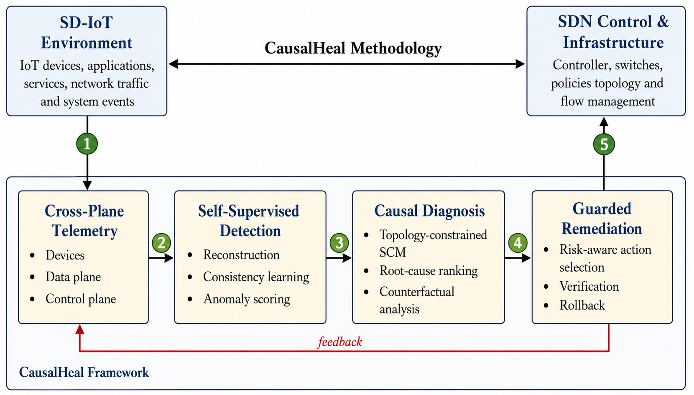

# CausalHeal: Self-Supervised Causal Diagnosis and Guarded Autonomous Remediation for Trustworthy SD-IoT
[https://doi.org/10.5281/zenodo.23320537](https://doi.org/10.5281/zenodo.24099814)

---

  

# Table of Contents

<a href= "#Overview">Overview</a> 
<a href= "#Prerequisites">Prerequisites</a> 
<a href= "#Getting Started">Getting Started</a> 
<a href= "#Author & Contact">Author & Contact</a>
---

---
  <h2>Author & Contact </h2>
  Falak Niaz  
  Department of Electronic Engineering, Kookmin University Seoul South Korea  
  https://wireless.kookmin.ac.kr/  
  Email: falakbhai300@gmail.com  
  Phone: +821059559661
   
